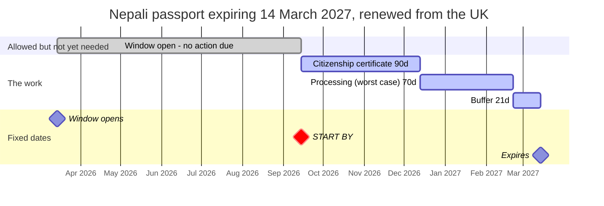
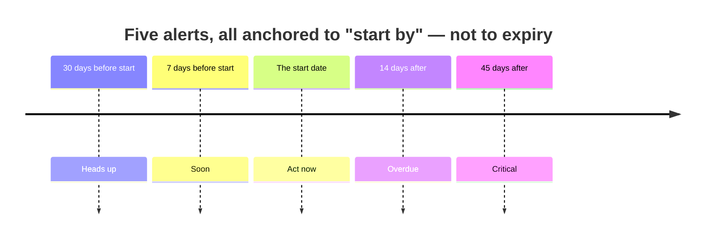
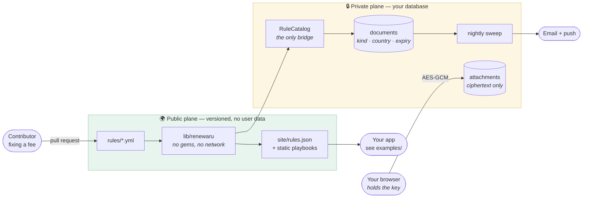
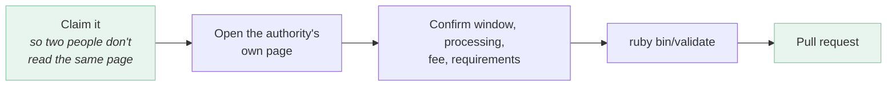

<div align="center">

# Renewal rules

**Every document you own has a deadline.**
**This is the open dataset that says which one is next — and exactly what to do about it.**

[](https://github.com/cdrrazan/Renewaru/actions/workflows/validate.yml)
[](https://github.com/cdrrazan/Renewaru/actions/workflows/app.yml)
[](LICENSE)
[](LICENSE)
[](rules/)
[](#status)

[Use cases](#use-cases) · [Quick start](#quick-start) · [The one number](#the-one-number-this-exists-to-compute) · [Architecture](#two-data-planes) · [Contributing](#helping) · [Security](SECURITY.md)

</div>

---

A calendar reminder tells you a passport expires on 14 March. It does not tell you to start in
November, because renewing from abroad takes ten weeks and needs a police certificate you have not
ordered yet.

**The failure is not memory. It is lead time and process ignorance** — and that is what this fixes.

<table>
<tr><td width="50%" valign="top">

**A calendar app knows**

```
Passport expires
14 March 2027
```

Correct, and useless. By the time it fires,
the fourteen weeks you needed are gone.

</td><td width="50%" valign="top">

**This knows**

```
Start by 14 September 2026
├── 90d  citizenship certificate
├── 70d  processing (worst case)
└── 21d  buffer
```

Six months earlier. Actionable.

</td></tr>
</table>

## Contents

- [Use cases](#use-cases)
- [Quick start](#quick-start)
- [The one number this exists to compute](#the-one-number-this-exists-to-compute)
- [Status](#status)
- [What the application does](#what-the-application-does)
- [How a rule works](#how-a-rule-works)
- [What the validator checks](#what-the-validator-checks)
- [Two data planes](#two-data-planes)
- [Repository layout](#repository-layout)
- [Helping](#helping)
- [Licence](#licence)

## Use cases

| You want to… | Start here |
|---|---|
| **Check one document, right now** | [`examples/ruby/start_date.rb`](examples/ruby/start_date.rb) — one command, no setup |
| **Build something on the data** | [`examples/`](examples/README.md) — runnable consumers in Ruby, Python, JS and jq |
| **Watch your family's documents** | [Quick start](#quick-start) → the app, with a [demo household](web/README.md#the-demo) |
| **Run it for yourself, privately** | [Self-hosting](#self-hosting) — one `docker compose up`, your own machine |
| **Understand the data format** | [SCHEMA.md](SCHEMA.md) — every field, and why it exists |
| **Fix a wrong figure** | [CONTRIBUTING.md](CONTRIBUTING.md) — edit one YAML file, no toolchain |
| **Verify a draft rule** | [Claim one](../../issues/new?template=verify-a-rule.md) — the most useful thing anyone can do here |
| **Know what a breach would expose** | [SECURITY.md](SECURITY.md) — precise about what is and is not protected |

### Who it is for

Anyone running a deadline in a country that is not the one issuing the document: migrants, work-visa
holders, international students, and people managing a parent's paperwork from abroad. Two or three
jurisdictions in parallel is the case no other product handles, and it is the case where a missed
deadline costs legal status rather than a late fee.

## Quick start

Needs Ruby 3.3, and MySQL 8.0+ or MariaDB 10.6+ for the application.

<table>
<tr><td valign="top" width="50%">

**Just the data** — no database, no gems

```sh
ruby bin/validate     # check every rule
ruby bin/build        # site/ + rules.json
ruby examples/ruby/start_date.rb \
  NP passport GB 2027-03-14
```

</td><td valign="top" width="50%">

**The whole application**

```sh
cd web
bin/setup --skip-server
bin/rails db:seed     # a household in trouble
bin/rails server
```

`demo@renewaru.test` / `demo-password-change-me`

</td></tr>
</table>

The seeded household holds every state the dashboard can reach. Two rows are the ones to look at:

> **Third-party insurance** — expired a fortnight ago
> **Vehicle registration** — due in two months, and **blocked**, because Nepal will not renew one
> without the other

Both dates look survivable on their own. The renewal is already blocked. That is the failure a
product storing only expiry dates cannot see, and it is why this one stores renewal *process*
instead. Full setup notes, including the database grant, are in [`web/README.md`](web/README.md).

### Self-hosting

```sh
cp .env.example .env && $EDITOR .env    # generate the secrets, do not choose them
docker compose up -d --build
```

Two containers: the application and MySQL. The app stays a single process — Solid Queue runs inside
Puma, so the nightly reminder sweep is not a service anyone can forget to start. That sweep is the
product.

Back up **both** volumes: `renewaru-db` holds the deadlines, `renewaru-storage` holds the encrypted
attachments, and neither is much use without the other.

> [!WARNING]
> The Docker image has never been built — this was developed without a Docker daemon available. The
> application has been exercised against a real MySQL server; the image around it has not. Build it
> once locally before pointing a domain at it. See [CHANGELOG.md](CHANGELOG.md).

## The one number this exists to compute

```
start_by = expires_on − processing.worst_case − slowest prerequisite − buffer
```

A real example, from [`rules/np/passport.yml`](rules/np/passport.yml), renewing from the UK:



Three consequences follow, and each is load-bearing:

| Decision | Why |
|---|---|
| **`worst_case`, never `typical`** | A date from the median is correct for the median applicant and useless for the tail — and the tail is who a missed deadline destroys. A Nepali driving licence is 30 days typical against **365** worst case. |
| **Prerequisites carry lead time** | A police certificate that itself takes six weeks is not a checklist item; it is six weeks of the plan. Without `obtain_lead_days` the computed date is confidently too late. |
| **A rule can be infeasible, and we say so** | Where the lead time exceeds the window, *no* legal start date finishes in time. Reported, not hidden — it is true, and it is the fact a reader most needs. |

### Reminders anchor to the start date, not the expiry



The cascade continues *past* the start date on purpose: the failure mode is not forgetting, it is
intending to deal with it and not getting round to it. Reminders go by email always, and by web push
where a household has enabled it.

> **No billing state ever stops a reminder.** Somebody whose card expires while abroad is precisely
> who needs the alert, so a lapsed subscription costs capacity — more people, more documents — and
> never safety. There is a test that walks every billing status and asserts it.

## Status

| | |
|---|---|
| Rules | 5 documents, 1 issuing country (Nepal) |
| Playbook pages | 21 |
| Verified | **0 — everything here is `draft`** |
| Infeasible | 9 of 21, reported rather than hidden |

The figures are structured, sourced, and internally consistent. They are **not yet confirmed against
the issuing authorities**, and every page that renders them says so prominently. [Verifying one](#helping)
is the most valuable contribution available.

## What the application does

| | |
|---|---|
| **Playbooks** | Every rule rendered per origin. Server-rendered, no account, crawlable. |
| **Start-date calculator** | Anonymous, nothing stored, the question in the URL so answers can be pasted into a forum thread. |
| **Reminder cascade** | Anchored to the start date, swept nightly, by email and web push. |
| **Prerequisite chains** | Warns when one document lapsing will block another's renewal. |
| **MRZ reading** | From a camera or pasted, with check-digit validation — a misread is caught, not stored as somebody's expiry date. |
| **Encrypted vault** | Scans encrypted in the browser. The server holds ciphertext and no key. |
| **Installable, offline** | Playbooks cached for a consulate queue or a plane. Public pages only; nothing behind a login touches disk. |

## How a rule works

```yaml
country_code: NP                  # who issues it, not where you live
document_kind: passport
window_opens_days_before: 365     # Nepal will not accept an application earlier
processing_days_abroad:
  typical: 42
  worst_case: 75                  # what the plan is built on
required_documents:
  - item: Nepali citizenship certificate
    obtain_lead_days: 90          # a prerequisite is lead time, not a checklist item
abroad_overrides:
  QA:                             # renewing from Doha is not renewing from London
    processing_days: { typical: 40, worst_case: 75 }
    additional_documents:
      - item: Qatar ID (QID)
```

One file, several pages: each `(document, origin)` pair renders as its own playbook, because nobody
searches for "Nepali passport renewal" — they search for "from the UK". Full field reference and
design rationale in [SCHEMA.md](SCHEMA.md).

## What the validator checks

`ruby bin/validate` enforces what JSON Schema cannot:

| Check | What it prevents |
|---|---|
| **Provenance** | A rule claiming `verified` without an official government source, a date and a named human. An override cannot inherit trust from a parent it does not share. |
| **Staleness** | A figure nobody has re-read in a year passing as current. Verification older than 365 days fails the build. |
| **Consistency** | A window running backwards, a worst case below the typical, a file whose location disagrees with its contents. |
| **Feasibility** | Silence about processes that cannot be completed in time. **Reported, not rejected** — the data is right and the bureaucracy is the problem. |

## Two data planes

The split is structural, not a convention.



**Public plane** — open, versioned, edited by pull request. No user data, so a contributor correcting
a fee comes nowhere near anybody's passport.

**Private plane** — document metadata is stored in the clear because the server must compute
start-by dates and cannot do that over ciphertext. Identifiers and notes are encrypted at rest.
Attachments are encrypted in the browser and the server has no key. [SECURITY.md](SECURITY.md) is
precise about what that does and does not protect.

Alerts and playbooks are never paywalled. Paywalling the safety feature would poison the trust the
whole thing rests on.

## Repository layout

| Path | What it is |
|---|---|
| [`rules/`](rules/) | The dataset — YAML, one file per country × document |
| [`schema/`](schema/) | The `RenewalRule` contract (JSON Schema 2020-12) |
| [`lib/`](lib/renewaru/) | Loader, timeline arithmetic, validator. No gems, no network. |
| [`bin/`](bin/) | [`validate`](bin/validate) and [`build`](bin/build) |
| [`examples/`](examples/) | Runnable consumers in four languages |
| [`web/`](web/) | The Rails 8 application — [its own README](web/README.md) |
| [`renewal-vault-spec.md`](renewal-vault-spec.md) | The product spec the code comments cite by section |

`rules/` sits at the top because it is the public artefact. Somebody correcting a renewal date should
never have to learn that the application exists.

## Helping

**The most valuable contribution is not a new country. It is verifying one that already exists.**

Every rule here says `draft` — the numbers are estimates nobody has checked against the issuing
authority. A wrong renewal date is worse than none, because it replaces a vague worry that prompts
checking with a false precision that prevents it.



Turning one draft into a sourced `verified` is worth more than five new drafts. It takes an evening
and a government website. [Claim one first](../../issues/new?template=verify-a-rule.md), then see
[CONTRIBUTING.md](CONTRIBUTING.md) for the bar.

Correcting a rule needs **no toolchain**: edit one YAML file, run `ruby bin/validate`, open a pull
request. No bundler, no database, no account.

Other ways in: [report a wrong figure](../../issues/new?template=wrong-rule.md) ·
[request a missing country](../../issues/new?template=missing-rule.md) ·
[report a bug](../../issues/new?template=bug.md) ·
[disclose a vulnerability privately](SECURITY.md)

## Caveat

Community-maintained reference information, **not legal advice**. Government processes change without
notice. Every page shows its last-verified date and links to the authority it came from — confirm
there before acting, and please [open a correction](CONTRIBUTING.md) when you find something wrong.

## Licence

| | |
|---|---|
| Rule data (`rules/`) | [CC BY 4.0](https://creativecommons.org/licenses/by/4.0/) — use it commercially, with attribution |
| Code (`lib/`, `bin/`, `test/`, `web/`) | MIT |

See [LICENSE](LICENSE). Community standards: [Code of Conduct](CODE_OF_CONDUCT.md) ·
[Contributing](CONTRIBUTING.md) · [Security policy](SECURITY.md) · [Changelog](CHANGELOG.md)
